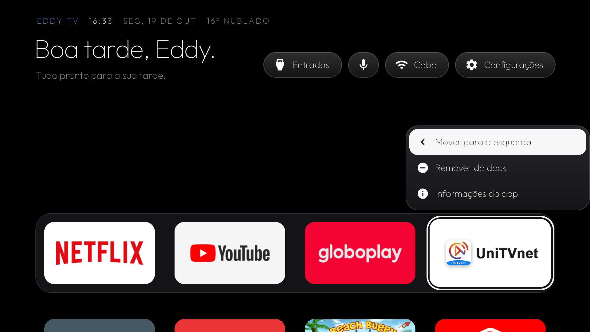
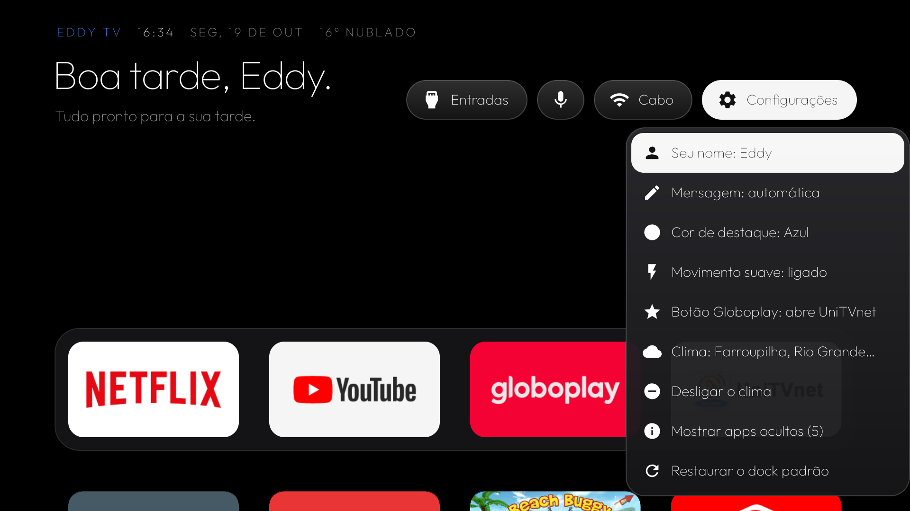
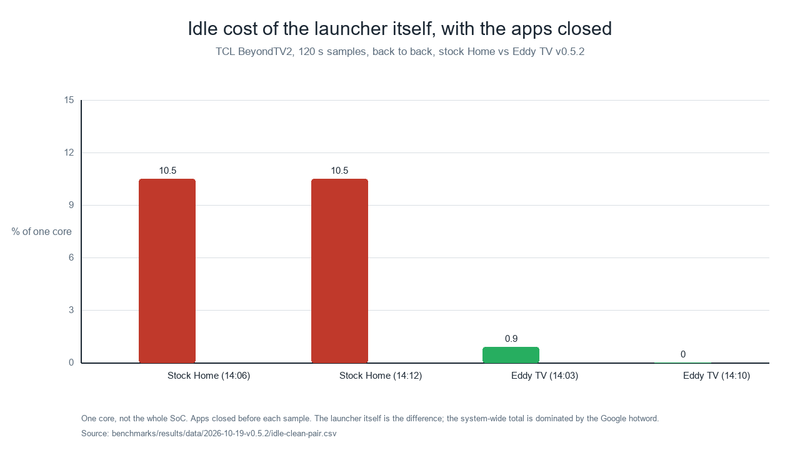
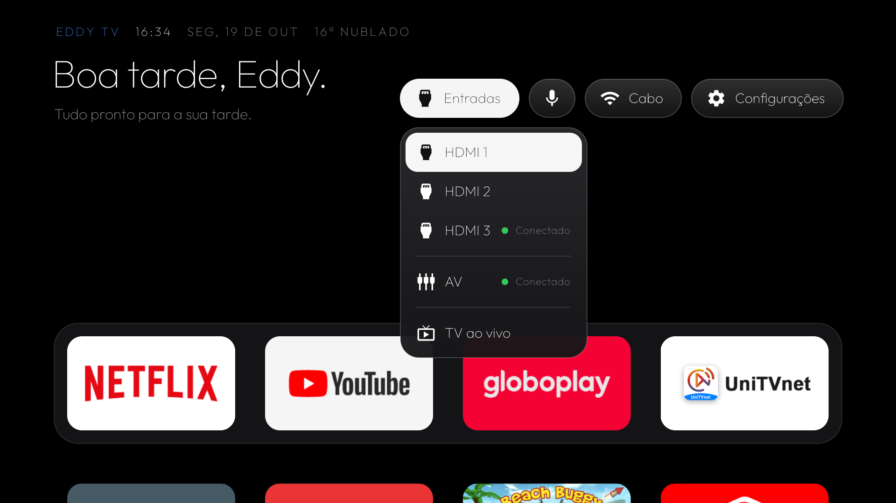
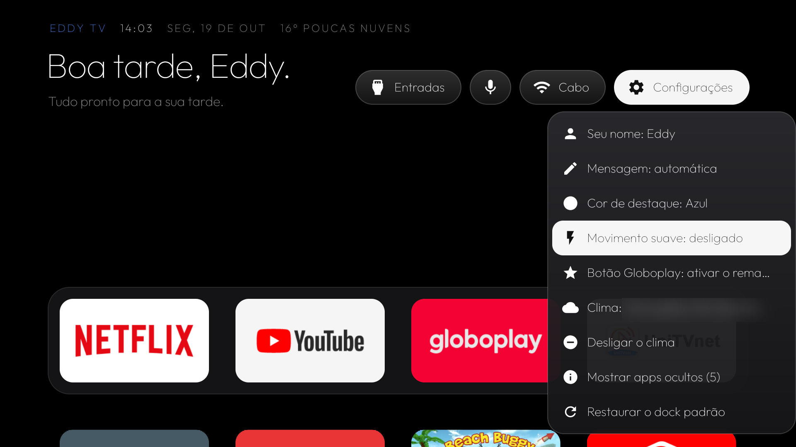
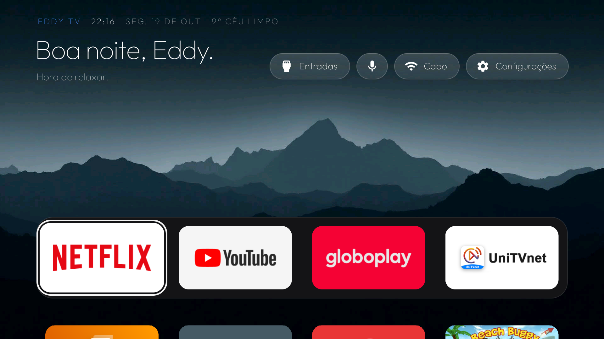

# CleanMyTCL-Android9

> Community-driven Android TV 9 optimization and lightweight launcher project for TCL televisions, with tested device profiles, reversible debloating and performance benchmarks.

🇧🇷 [Leia em português](README.pt-BR.md)

**Fork of [CleanYourTV](https://github.com/Gathin23/cleanyourtv) (formerly `tv-vibehack`) by Gathin, MIT.**  
CleanYourTV targets any Android/Google TV. This fork narrows the scope to **TCL televisions running Android TV 9**, and adds what we needed to make one of them fast and stay reversible: per-model profiles, a measured launcher, test/benchmark scripts and recovery procedures.  
See [NOTICE.md](NOTICE.md) for credits and [docs/PROVENANCE.md](docs/PROVENANCE.md) for what came from where.

---

## 📸 Screenshots

*Captured on the real device (TCL BeyondTV2, R851T02 V660). The weather location in the options
screenshot is blurred for privacy; the rest are the original PNGs.*

| Stock Android TV Home | Eddy TV Home (v0.5.4) |
|:---:|:---:|
|  |  |
| *Sponsored and recommendation rows, network content fetched on every open, permanent animation at 60 fps* | *Greeting by time of day, weather line, no sponsored row, no feed, 0 fps while idle* |

| App grid (D-pad) | Tile menu |
|:---:|:---:|
|  |  |
| *Rows of installed apps; in ultralight mode the grid jumps instead of scrolling* | *Long-press a tile: pin it to the dock, open its info, hide it* |

| On-TV options | Idle cost of the launcher itself |
|:---:|:---:|
|  |  |
| *Everything is set on the TV itself: user name, message, accent colour, motion, weather, hidden apps, reset* | *Same TV, same session, apps closed: the stock Home costs 10.5% of one core and redraws at 3.8 fps; Eddy TV costs 0.0–0.9% and redraws at 0.03–0.17 fps. [Full method and results](benchmarks/results/2026-10-19-v0.5.2.md).* |

| Inputs menu (HDMI / Live TV) | Ultralight mode |
|:---:|:---:|
|  |  |
| *The HDMI inputs and Live TV, straight from the Home: keys 1–3 open the three HDMI inputs this unit lists, in the same order as the Inputs menu (the launcher maps keys 1–4 to the inputs the system reports; there is no fourth input entry here)* | *Smooth motion off: the focus jumps instead of gliding, 1 frame drawn per move instead of 38* |

### Aurora wallpaper (v0.5.6)



*Static 1920×1080 asset, decoded off the main thread at RGB_565; ultralight always uses black. The
wallpaper keeps the key response and spring duration, but adds ~9 MB PSS and a measured jank cost
during the spring — see the [wallpaper A/B](benchmarks/results/2026-10-19-v0.5.6-wallpaper.md).*

> Every number in [benchmarks/results/](benchmarks/results/) is tagged with the exact launcher
> version and the conditions it was measured in. Charts are generated from the measured data by
> `scripts/tcl-make-charts.py`; no number is typed into a drawing tool.

> **Add your own screenshots:** run `scripts/tcl-screencap.sh <file.png>` (or the PowerShell
> `scripts\tcl-capture-screenshot.ps1`). Both write real binary PNGs — see
> [docs/SCREENSHOTS.md](docs/SCREENSHOTS.md) for why the obvious one-liner does not work — and
> check the result before committing.

---

## Is my TV supported?

**Only one model is validated so far.** Do not assume your TCL works because it also runs Android 9: firmware, chipset and regional app sets differ. Check the [compatibility matrix](COMPATIBILITY.md).

| Device profile | Chipset | Firmware | Status |
|---|---|---|---|
| [TCL BeyondTV2](devices/tcl-beyondtv2-rtd2851-r851t02-v660/) | Realtek RTD2851 | R851T02 V660 (Android 9, API 28, 32-bit, 2 GB) | Partially validated (see matrix) |

---

## Principles

1. **Performance first.** No feature is kept if it makes Home, navigation or app launch slower. Every change is measured (p50 and tail latency) against the previous version. The optional wallpaper is the documented exception: it keeps key response and spring duration, but adds jank/PSS; ultralight stays black and the cost is published.
2. **Reversible.** System apps are only `pm disable-user`'d, one at a time, with a smoke test and an undo command. Nothing is uninstalled from `/system`. No root, no firmware flashing.
3. **Evidence over claims.** Speed numbers come with method, device and raw-data location ([benchmarks/](benchmarks/)). Untested means untested.
4. **The stock launcher is never disabled before the new Home is installed and verified**, and the way back is documented ([docs/RECOVERY.md](docs/RECOVERY.md)).

---

## Repository layout

| Path | What |
|---|---|
| `launcher/` | Lightweight Home (`com.gathin.tvhome` code from upstream + TCL features: ultralight mode, D-pad menus, HDMI shortcuts, voice button, on-TV settings, configurable greeting, 4/5/6 columns, family profiles, optional static aurora wallpaper) |
| `scripts/` | Windows PowerShell + Git Bash tools: backup, restore, safe disable, smoke test, reboot test, benchmarks |
| `tools/` | Upstream CleanYourTV tools (`tv.py`, `disable.*`, `restore.*`) — kept unchanged |
| `devices/` | Per-model profiles: debloat list, protected packages, what was tested |
| `benchmarks/` | Methodology and curated results |
| `docs/` | Setup on Windows 11, ADB, backup/restore, recovery, personalization, known issues, provenance |
| `examples/` | Upstream debloat lists from other brands (reference only) |
| `private/` | Your local data. Ignored by git, never published |

---

## Quick start (Windows 11)

Full guide: [docs/GETTING-STARTED.md](docs/GETTING-STARTED.md).

```powershell
$env:TCL_TV_HOST = "<tv-ip>"                                              # your TV's IP
powershell -ExecutionPolicy Bypass -File scripts\tcl-backup.ps1           # 1. snapshot current state
bash scripts/tcl-smoke.sh                                                 # 2. check essential functions
bash scripts/tcl-try-disable.sh com.tcl.bi                                # 3. disable ONE package, test, auto-revert on failure
powershell -ExecutionPolicy Bypass -File scripts\tcl-restore.ps1          # dry-run of going back to the baseline
```

---

## Relationship with upstream

This repo keeps CleanYourTV's history up to commit `9ef40c1` and branches from there. Upstream has moved on (v2.x, themes, Home-key service). We track it as the `upstream` remote and **cherry-pick** fixes after reviewing conflicts, behavior changes and measured performance impact ([docs/BRANCHING.md](docs/BRANCHING.md)). Improvements that are not TCL-specific should be offered back to CleanYourTV.

---

## Disclaimer

Use at your own risk. Disabling the wrong package can break HDMI, the remote, voice or the Play Store. Always back up first and change one thing at a time. Not affiliated with TCL or Google.

License: MIT ([LICENSE](LICENSE)). Third-party components: [NOTICE.md](NOTICE.md).
