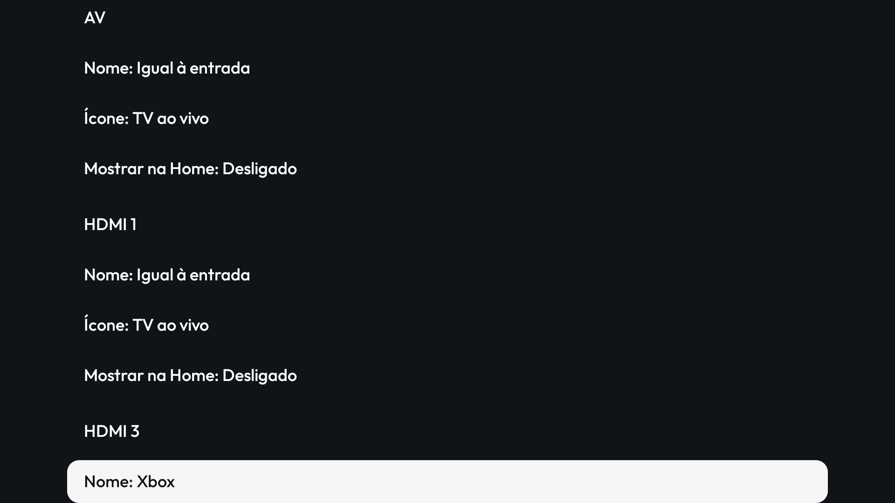
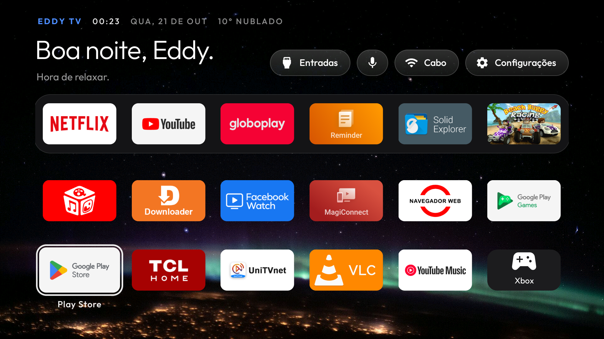
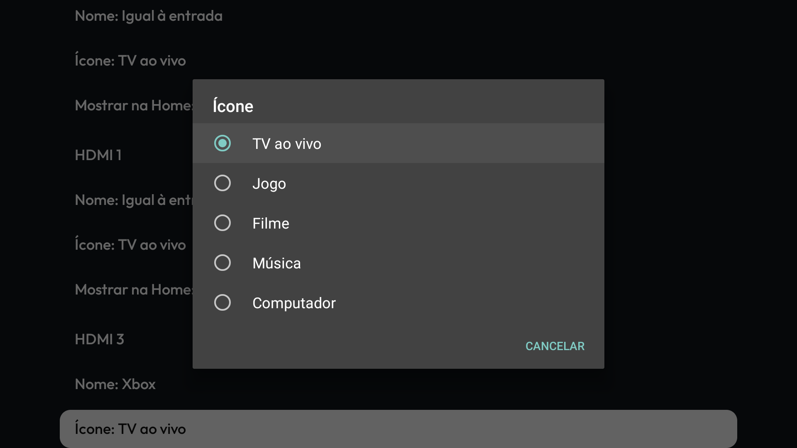

# Cartões de entrada (HDMI/AV) na Home

Recurso trazido de `eddysangalli/cleanyourtv` (commit `a3f37b5`, "launcher: HDMI/AV input cards on
Home") e adaptado a este fork. Não é um copiar-colar: o repositório de origem usa `Config`/`Cards`,
este fork usa `HomePrefs`/`AppLoader`.

## O que faz

Cada porta HDMI/AV que a TV reporta vira um **cartão na Home**, com nome próprio ("Xbox"), ícone
escolhido (TV ao vivo, jogo, filme, música, computador) e visibilidade própria. O cartão abre a porta,
não um app.

| Tela | Captura |
|---|---|
| Configuração no controle |  |
| Cartão na Home |  |
| Escolha de ícone |  |

Chega-se por **segurar OK em Configurações** na Home → "Cartões de entrada".

## Como foi adaptado

| Peça | Origem | Adaptação |
|---|---|---|
| `InputCards.java` | repo geral | veio inteiro; lê `TvInputManager`, guarda `input_card.<id>.<campo>` |
| `InputCardsActivity.java` | repo geral | `Config.SETTINGS_NAME` → `HomePrefs.PREFS_NAME` |
| `AppAdapter` | repo geral | `Entry.inputId`, `setInputCards()`; o tile com `inputId` abre a porta e o long press não faz nada |
| `MainActivity` | repo geral | resolve os cartões no rebind da grade; abre a porta pela mesma intent `ACTION_VIEW` do menu Entradas |
| Ícones, layout, strings | repo geral | quatro ícones novos; strings em en, pt-BR, de e es |
| Estilo das linhas | repo geral | `SettingsRow`, sobre o `input_row_bg` que já existia |

## Dois defeitos do commit original, corrigidos

1. **Cabeçalhos focáveis.** Os blocos "HDMI 1", "AV" usavam o mesmo estilo das linhas, então o
   D-pad parava neles sem ação. Agora são texto simples, `focusable=false`.
2. **Foco perdido.** Renomear, trocar o ícone ou alternar "Mostrar na Home" reconstruía a lista e
   devolvia o foco ao começo. Agora o foco volta para a linha que estava sendo editada.

Também trocamos o `recreate()` do commit original por uma atualização só da grade (`showApps` com a
lista em cache): `recreate()` derrubaria o foco e consultaria todos os apps de novo.

## Custo

- **Sem consulta durante a navegação**: a lista de entradas é lida no rebind da grade, não a cada
  movimento do controle.
- **Sem serviço, sem rede, sem permissão nova.** Os cartões usam `TvInputManager` e `TvContract`, que
  já estavam disponíveis no Android 9 desta TV.
- Cada cartão visível é um tile a mais na grade; desligado, não custa nada.

## Testado na BeyondTV2 V660 (21/10/2026)

| Passo | Resultado |
|---|---|
| Segurar OK em Configurações → Cartões de entrada | abre a tela, em pt-BR |
| Renomear HDMI 3 para "Xbox" | salvo; persiste ao reabrir |
| Escolher o ícone "Jogo" | aplicado; o foco fica na linha |
| "Mostrar na Home: Ligado" | cartão aparece na grade, no fim, com ícone e rótulo |
| Abrir o cartão | abre `com.tcl.tv/.TVActivity` naquela entrada |
| MENU no cartão | não faz nada (não há app atrás) |
| Voltar à Home | foco preservado |

**Limite do teste:** a TV reporta AV, HDMI 1 e HDMI 3 como entradas de passagem; o HDMI 2 não aparece
no `TvInputInfo` desta unidade, então não há cartão para ele. A abertura foi conferida pelo
`mResumedActivity`, não por vídeo (não há fonte ligada nas portas).

**Pendente:** a configuração foi feita por `am start` numa build com a activity exportada
temporariamente, porque `input keyevent --longpress` não chega como long press neste firmware
(upstream #485) e o `sendevent` no receptor IR não foi confiável. O caminho pelo menu precisa ser
refeito com o controle físico.
